# Syntex

**A video player for Android TV boxes and a library on a home NAS.** Syntex opens on a file browser for SMB and WebDAV shares, shows a folder of films or a season as pictures, and plays what is in it: Dolby Vision and HDR, Blu-ray rips, old AVI and DivX, with the screen switched to the film's frame rate. It is driven by a remote, and a TV is what it is made and tested on.

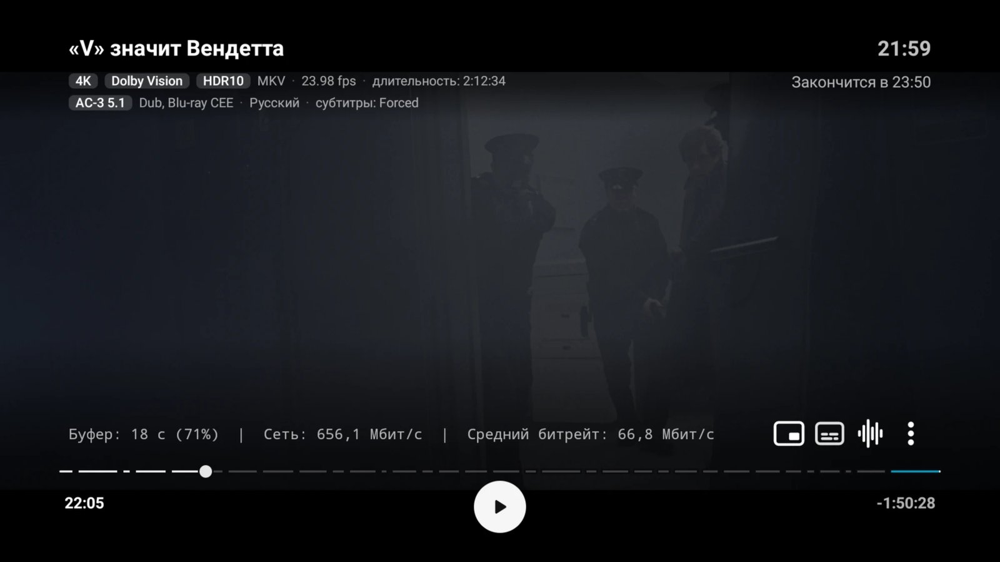

*Screenshots show the Russian interface; the app also runs in English.*

 * **Made for:** Android TV and Google TV boxes (tested on an NVIDIA Shield and a Dune HD Homatics), with films and series on a NAS
 * **Phones and tablets:** Syntex installs and plays there as well, but it is not tested on them and not every feature is adapted to a touch screen
 * **Android 7.0 or later**, one APK for all devices. Interface languages: English and Russian
 * No ads, no tracking, no accounts

A personal project made for my own use and shared as it is — see [Support](#support).

<details>
<summary>По-русски</summary>

**Видеоплеер для приставок Android TV и домашней библиотеки на NAS.** Syntex открывается на файловом браузере для общих папок SMB и WebDAV, показывает папку с фильмами или сезон картинками и играет то, что в ней лежит: Dolby Vision и HDR, рипы Blu-ray, старые AVI и DivX — с переключением экрана на частоту кадров фильма. Управляется пультом; телевизор — то, для чего он сделан и на чём проверяется.

*На снимках — русский интерфейс; есть и английский.*

 * **Для чего:** приставки Android TV и Google TV (проверяется на NVIDIA Shield и Dune HD Homatics) и фильмы и сериалы на NAS
 * **Телефоны и планшеты:** Syntex ставится и играет и на них, но там не проверяется, и не все функции приспособлены под сенсорный экран
 * **Android 7.0 и новее**, один APK на все устройства. Языки интерфейса: английский и русский
 * Без рекламы, слежки и учётных записей

Личный проект, сделанный для себя и выложенный как есть — см. «Support».

</details>

## Install

Download `Syntex.v<version>.apk` from [Releases](https://github.com/SergeiAK/syntex/releases) and install it. From then on the app checks this repository for new releases itself, shows what changed and installs the update through the system installer.

<details>
<summary>По-русски</summary>

Скачать `Syntex.v<версия>.apk` из [Releases](https://github.com/SergeiAK/syntex/releases) и установить. Дальше приложение само проверяет выпуски в этом репозитории, показывает, что изменилось, и ставит обновление через системный установщик.

</details>

## What makes it different

### Seek preview

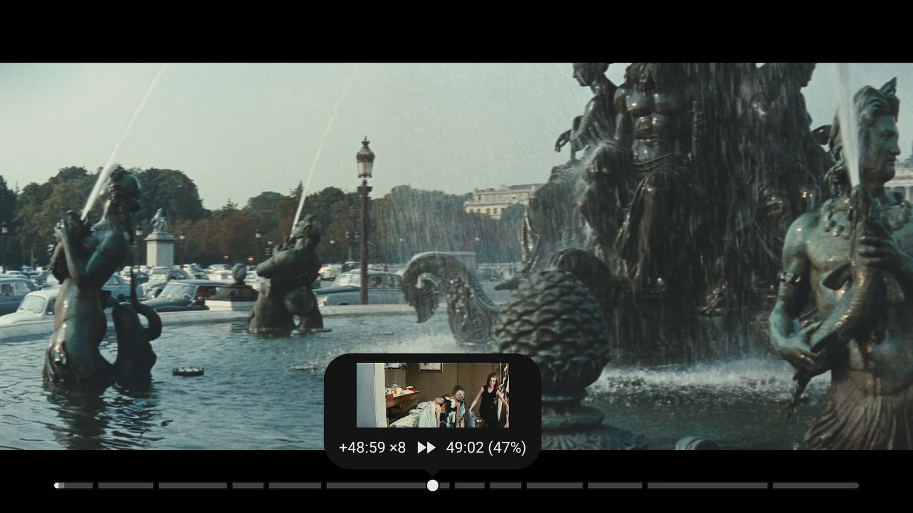

While you seek with the remote, the card over the bar shows the frame you will land on, how far you are going and how fast, and the target time. Playback keeps running underneath and jumps once, when you stop. The frames come from Jellyfin's trickplay set if it lies next to the file; without one they are cut from the file itself, or the card shows the time alone. On by default (Settings → On screen).

<details>
<summary>По-русски</summary>

Пока перематываете пультом, карточка над полосой показывает кадр, на который попадёте, на сколько и с какой скоростью идёт перемотка и куда придёте. Воспроизведение под ней не останавливается; прыжок один — когда отпустили. Кадры берутся из набора trickplay Jellyfin, если он лежит рядом с файлом; без него они вырезаются из самого файла или карточка показывает только время. Включено по умолчанию (Настройки → На экране).

</details>

### Seeking your way

Settings → Seeking lets each part of the remote's seeking be set on its own, so it can be made to feel like the player you are used to:

 * **A short press:** steps that grow with quick presses (3, 10, 30, 60 s), or a fixed step — chosen separately for back and forward, from 3 to 30 s
 * **Holding the key:** steps that grow, the fixed step, or a glide — the mark moves by itself, each press in the same direction speeds it up from 2× to 16×, the other direction slows it down and stops it; OK lands, Back returns to where you were
 * **The step on the seek bar:** by the length of the file (a minute, or a twentieth of a short one), or a fixed 1, 2 or 5 minutes
 * **Without trickplay frames beside the file:** frames cut from the file where the box can decode them, or the time alone

<details>
<summary>По-русски</summary>

Настройки → Перемотка: каждую часть перемотки пультом можно настроить отдельно — так, чтобы она была похожа на привычный плеер:

 * **Короткое нажатие:** шаг, растущий при частых нажатиях (3, 10, 30, 60 с), или постоянный шаг — отдельно назад и вперёд, от 3 до 30 с
 * **Удержание кнопки:** растущие шаги, постоянный шаг или скольжение — отметка едет сама, каждое нажатие в ту же сторону ускоряет её от 2× до 16×, в обратную — замедляет и останавливает; OK — перейти, «Назад» — вернуться
 * **Шаг на полосе:** по длине файла (минута или двадцатая часть короткого) или постоянный — 1, 2 или 5 минут
 * **Без кадров trickplay рядом с файлом:** кадры из самого файла, если приставка их декодирует, или только время

</details>

### Player controls on one plate

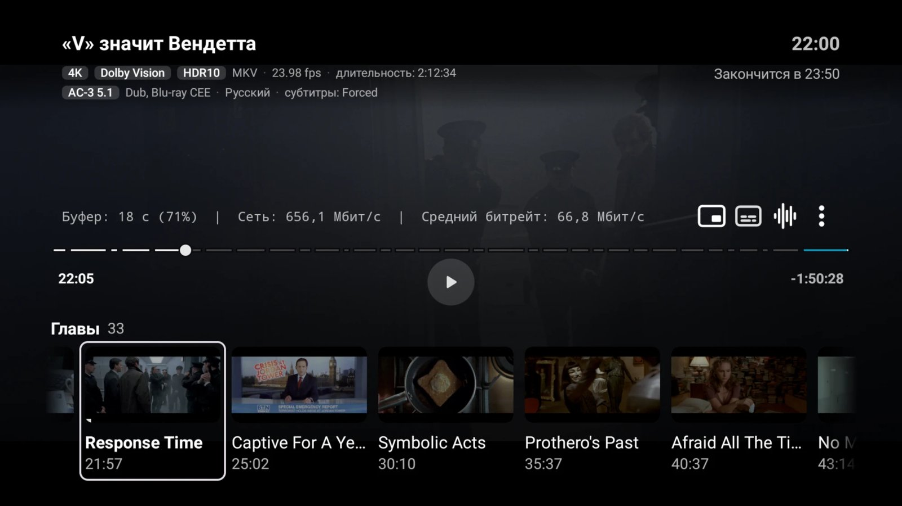

 * **One plate** for the header, the bar and the buttons, as a card or a fade (Settings). The header is compact: title, clock, the time playback will end, and the main facts of the file as tags — resolution, Dolby Vision / HDR10, container, frame rate, audio codec and channels, dub, subtitles. A series logo is shown where the launching app sends one
 * **Chapters** of the file are marks on the bar and a row of frames under the controls: pick one to jump there. Intros and end credits named as chapters are skipped by their name
 * **The playlist** — the rest of the folder or the season — is a row of frames in the same place

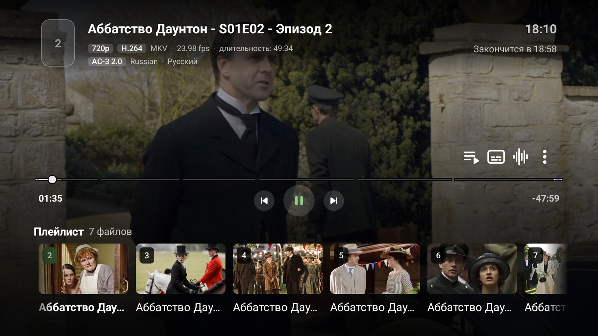

 * OK on the bar plays and pauses; the remaining time follows the playback speed; a seek that lands at the very end stops 5 s short of it

<details>
<summary>По-русски</summary>

 * **Одна плашка** для шапки, полосы и кнопок — карточкой или затемнением (в настройках). Шапка компактная: название, часы, время окончания и главное о файле метками — разрешение, Dolby Vision / HDR10, контейнер, частота кадров, аудиокодек и каналы, озвучка, субтитры. Логотип сериала — если приложение-источник его прислало
 * **Главы** файла — отметки на полосе и ряд кадров под кнопками: выбрали — перешли. Вступление и титры, размеченные главами, пропускаются по названию
 * **Плейлист** — остальное в папке или сезоне — тем же рядом кадров
 * OK на полосе — пауза и продолжение; оставшееся время учитывает скорость воспроизведения; перемотка в самый конец останавливается за 5 с до него

</details>

### A library on a NAS

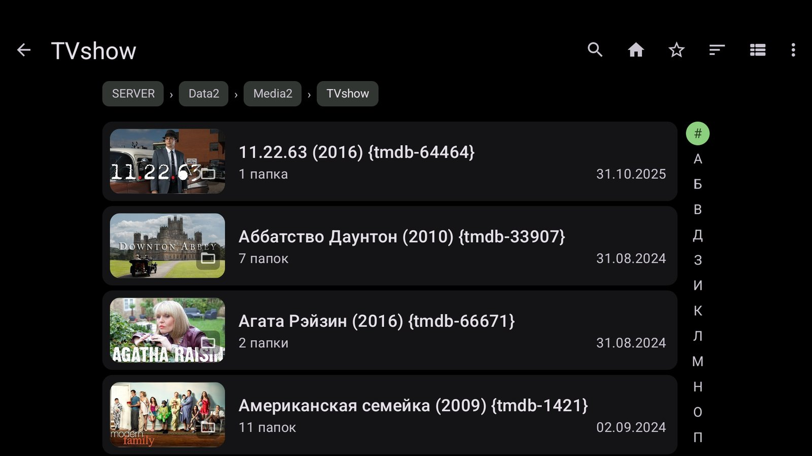

 * **Pictures for folders and files** — the ones a media manager leaves next to the videos (`<name>-thumb.jpg`, `<name>.jpg`, `folder.jpg`, `poster.jpg`, `seasonNN-poster.jpg`; Kodi, Jellyfin, Emby and tinyMediaManager names), the cover stored in a Matroska or MP4 file, and otherwise a frame of the video. Locally, over SMB and over WebDAV
 * **Each folder says what is inside:** "7 folders", "8 videos"
 * **A bar of first letters** beside a long folder sorted by name, for Latin and Cyrillic

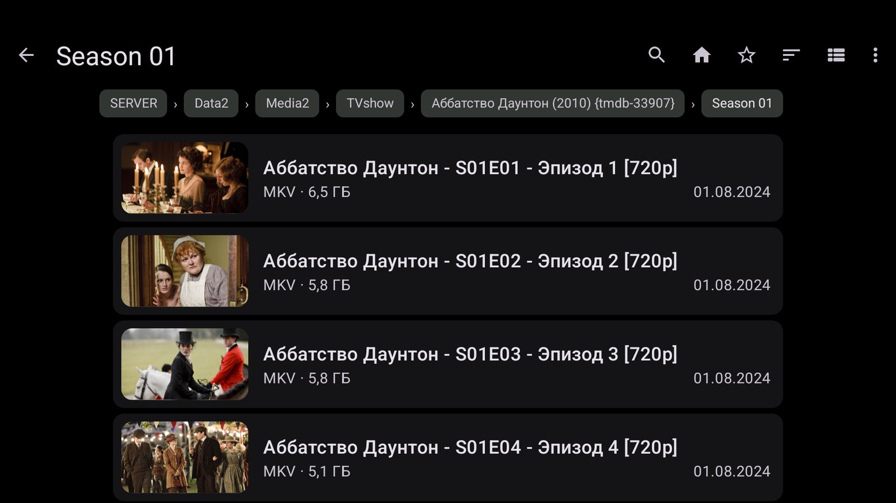

 * **Files show their type and size** on their own line, with the date and the full year
 * **Sort per folder:** by name, by date, by file type or by size, both ways; every folder remembers its own order

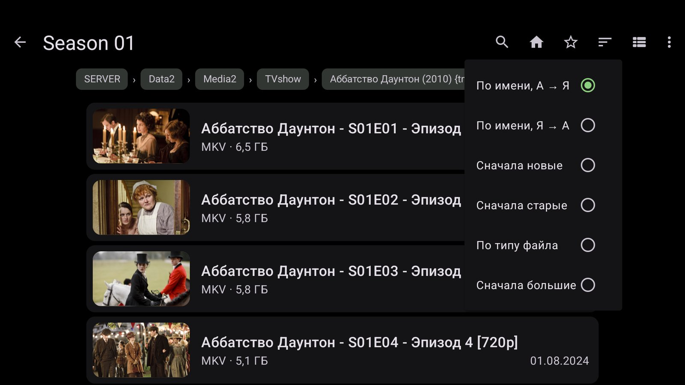

 * Long names scroll when focused; `m2ts`, `mts`, `mpg`, `vob` and `flv` files are listed; a button returns to the start page from anywhere

<details>
<summary>По-русски</summary>

 * **Картинки у папок и файлов** — те, что медиаменеджер кладёт рядом с видео (`<имя>-thumb.jpg`, `<имя>.jpg`, `folder.jpg`, `poster.jpg`, `seasonNN-poster.jpg`; имена Kodi, Jellyfin, Emby и tinyMediaManager), обложка внутри Matroska или MP4, иначе — кадр из видео. Локально, по SMB и WebDAV
 * **У папки видно, что внутри:** «7 папок», «8 видео»
 * **Полоса первых букв** рядом с длинной папкой, отсортированной по имени, — латиница и кириллица
 * **У файлов — тип и размер** отдельной строкой, дата с полным годом
 * **Сортировка у каждой папки своя:** по имени, по дате, по типу файла, по размеру, в обе стороны
 * Длинные имена прокручиваются в фокусе; показываются `m2ts`, `mts`, `mpg`, `vob`, `flv`; кнопка возврата на стартовую страницу отовсюду

</details>

### Fast and patient network

 * **SMB several times faster** than a plain SMB client: several reads in flight, read-ahead after samba's own client, no signing where the server does not ask for it
 * **A choice of protection** in Settings: automatic (signing first, encryption only where signing is slow), encryption, or no signing
 * **A minute's patience** for a network that went away, and a buffer that refills from 40 s — a 30-second Wi-Fi drop does not stop the film. Only the connection that failed is replaced; the buffer never takes more than 40 % of the memory

<details>
<summary>По-русски</summary>

 * **SMB в разы быстрее** обычного клиента: несколько чтений одновременно, упреждающее чтение по образцу клиента samba, без подписи там, где сервер её не требует
 * **Выбор защиты** в настройках: автоматически (сначала подпись, шифрование — только где подпись медленная), шифрование или без подписи
 * **Минута терпения**, если сеть пропала, и буфер, который начинает пополняться с 40 с, — 30-секундный обрыв Wi-Fi фильм не останавливает. Заменяется только упавшее соединение; буфер не занимает больше 40 % памяти

</details>

### Subtitles next to the file

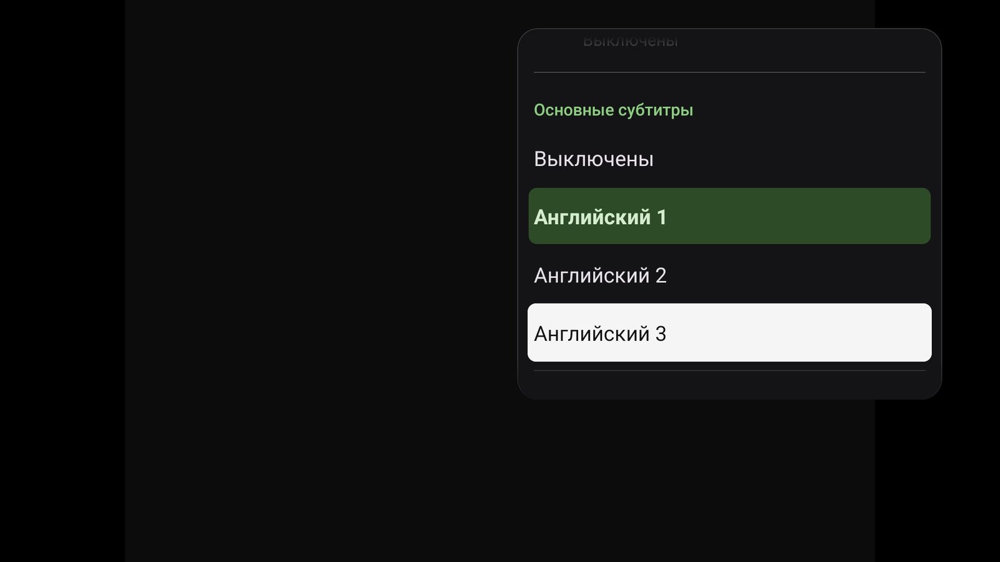

 * **Subtitle files beside a video** on a share, on WebDAV or on the device are found, converted to UTF-8 and attached
 * **Several of them** (`.eng1.srt`, `.eng2.srt`, `.eng3.srt`) all go to the picker under their own names; the first one in your languages is switched on, and the one you pick is remembered for that file
 * **Forced subtitles only** when the dub is already in your language

<details>
<summary>По-русски</summary>

 * **Файлы субтитров рядом с видео** — в сетевой папке, на WebDAV или на устройстве — находятся, переводятся в UTF-8 и подключаются
 * **Если их несколько** (`.eng1.srt`, `.eng2.srt`, `.eng3.srt`) — все попадают в список под своими именами; включаются первые на ваших языках, а выбранные вами запоминаются для этого файла
 * **Только форсированные субтитры**, если озвучка уже на вашем языке

</details>

### The screen follows the film

 * **Frame rate matching on by default on a TV:** the refresh rate as the video, doubled, or the highest the TV takes; an option for TVs that do 24p poorly; the mode changes only to an exact rate, with a set pause after the switch so the TV catches up
 * The frame rate is measured by the frames themselves when the container does not state it, and the decoder is told the rate the stream states
 * Resolution can be matched as well

<details>
<summary>По-русски</summary>

 * **Подбор частоты включён по умолчанию на ТВ:** частота как у видео, удвоенная или наибольшая; настройка для телевизоров, которые плохо показывают 24p; переключение только на точную частоту и пауза после него, чтобы телевизор успел
 * Частота кадров считается по самим кадрам, если контейнер её не указывает; декодеру сообщается частота, заявленная в потоке
 * Можно подбирать и разрешение

</details>

### Statistics

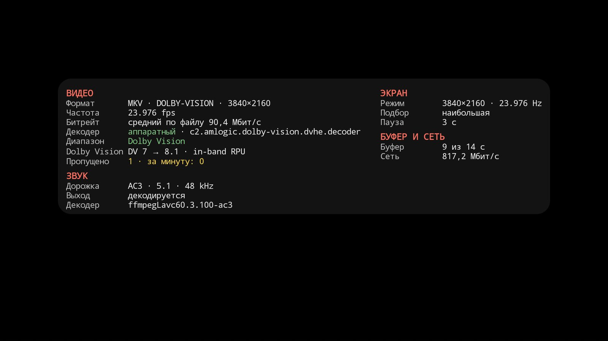

INFO (or Menu) on the remote opens a card with what is really happening: the container, codec and resolution, the frame rate counted by frames, bitrate, decoder (hardware or software), dynamic range — here a Dolby Vision profile 7 film converted to profile 8.1 on the fly — and dropped frames; the audio track, whether it is decoded or passed through, and by what; the display mode and how it was chosen; the buffer and the network speed. Device information has a screen of its own.

<details>
<summary>По-русски</summary>

INFO (или Menu) на пульте открывает карточку с тем, что происходит на самом деле: контейнер, кодек и разрешение, частота по кадрам, битрейт, декодер (аппаратный или программный), динамический диапазон — на снимке фильм в Dolby Vision профиля 7, на лету переведённый в профиль 8.1, — и пропущенные кадры; звуковая дорожка, декодируется она или идёт на ресивер и чем; режим экрана и как он выбран; буфер и скорость сети. Сведения об устройстве — на отдельном экране.

</details>

### Sound

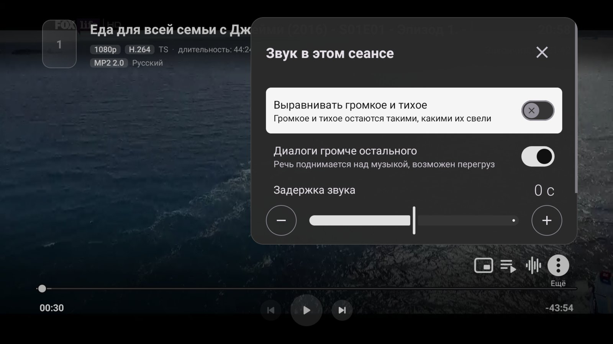

 * **Audio delay in the sound panel,** applied while you listen, and remembered for each output — speakers, HDMI, Bluetooth
 * Loud and quiet passages brought closer together for late hours; speech raised above music and effects
 * **The same dub on the next episode:** the audio and subtitle choice made in one episode is carried to the next one, matched by language and name rather than by track number
 * Dolby and DTS sent untouched to an AV receiver, and a way to force it on boxes that report less than the receiver can take

<details>
<summary>По-русски</summary>

 * **Задержка звука в панели звука** — меняется сразу на слух и запоминается для каждого выхода: динамики, HDMI, Bluetooth
 * Громкие и тихие места ближе друг к другу — для позднего часа; речь громче музыки и эффектов
 * **Та же озвучка в следующей серии:** выбор звука и субтитров переносится на следующую серию — по языку и названию, а не по номеру дорожки
 * Dolby и DTS уходят на ресивер без изменений; для приставок, которые сообщают о ресивере меньше, чем он умеет, — принудительный режим

</details>

### Files Android cannot play

 * **A software video decoder** (FFmpeg 7.1) for what the device refuses: MPEG-4 ASP (XviD, DivX), H.263, MS-MPEG-4, VC-1, MPEG-1/2, MJPEG
 * **Blu-ray M2TS:** TrueHD plays by its AC-3 core, Dolby Digital Plus and DTS-HD tracks are read
 * **Matroska without an index** seeks (an estimate by bitrate, then the nearest cluster) and skips a broken stretch instead of stopping
 * **Fragmented MP4** seeks with or without an index; **AVI** keeps exact audio times after a seek and plays packed B-frames in the right order; MPEG-1 program streams and QuickTime without `ftyp` keep their sound
 * AC-3, E-AC-3, DTS, DTS-HD and TrueHD are decoded by the app itself when the box cannot

<details>
<summary>По-русски</summary>

 * **Программный видеодекодер** (FFmpeg 7.1) для того, что устройство не берёт: MPEG-4 ASP (XviD, DivX), H.263, MS-MPEG-4, VC-1, MPEG-1/2, MJPEG
 * **Blu-ray M2TS:** TrueHD играет по ядру AC-3, дорожки Dolby Digital Plus и DTS-HD читаются
 * **Matroska без индекса** перематывается (оценка по битрейту, затем ближайший кластер) и пропускает битый участок вместо остановки
 * **Фрагментированный MP4** перематывается с индексом и без; **AVI** держит точное время звука после перемотки и показывает упакованные B-кадры в правильном порядке; MPEG-1 PS и QuickTime без `ftyp` — со звуком
 * AC-3, E-AC-3, DTS, DTS-HD и TrueHD приложение декодирует само, если приставка не может

</details>

### Resume

 * Where to start is asked, or not, in one of four modes; a file watched past 95 % or into its end credits starts over
 * A seek made while the resume question is on screen is kept

<details>
<summary>По-русски</summary>

 * Спрашивать, откуда начать, или нет — четыре режима; файл, досмотренный дальше 95 % или до титров, начинается сначала
 * Перемотка, сделанная, пока на экране вопрос, сохраняется

</details>

### Sync between boxes

 * Where you stopped, what you have watched and your settings travel between TVs: stop a film on one box and continue it on another
 * Three ways, any of them or together: a **shared folder** on a NAS (SMB, WebDAV, or local), where every box writes its own file and reads the others'; a **hub** — a small http server on the NAS that keeps one JSON per box (`PUT /sync/{box}`, `GET /sync?except={box}` → `{"documents": [...]}`; ours is Discovery-hub); or **export and import** of a file by hand
 * A file is the same film on every box even when one reached the share by its address and another by its name. Of two entries the newer wins, one by one, so two boxes playing at once lose nothing
 * **Watched** is a mark of its own: set by playing to the end, by leaving in the closing 5 %, by an episode moving on, or by hand from a row's menu; a watched row shows a full bar
 * Settings that depend on the box stay where they are: frame rate and resolution, audio output and delays, decoders, buffer, nickname and room password. Each of the three — positions, watched, settings — has its own switch

<details>
<summary>По-русски</summary>

 * Место остановки, просмотренное и настройки переходят между телевизорами: остановили фильм на одной приставке — продолжили на другой
 * Три способа, по отдельности или вместе: **общая папка** на NAS (SMB, WebDAV или на устройстве) — каждая приставка пишет свой файл и читает чужие; **hub** — небольшой http-сервер на NAS, хранящий по одному JSON на приставку (`PUT /sync/{box}`, `GET /sync?except={box}` → `{"documents": [...]}`; у нас это Discovery-hub); **экспорт и импорт** файлом вручную
 * Один фильм — одна запись на всех приставках, даже если шара подключена на одной по адресу, а на другой по имени. Из двух записей побеждает более новая, по каждой отдельно, — одновременный просмотр на двух ничего не теряет
 * **«Просмотрено»** — отдельная отметка: ставится при досмотре до конца, при выходе в последних 5 %, при переходе серии и вручную из меню строки; у просмотренной строки полоса полная
 * Настройки, зависящие от приставки, остаются на ней: частота и разрешение, вывод и задержки звука, декодеры, буфер, ник и пароль комнаты. У каждой из трёх частей — позиций, отметок, настроек — свой переключатель

</details>

### Launchers: LAMPA and media servers

 * **LAMPA.** Syntex understands LAMPA's playlist launch — episodes with their numbers, segments to skip, positions, qualities, subtitles — resumes the way the launcher asks, carries the dub to the next episode, and reports the position of every episode back so LAMPA keeps your progress. **For all of this LAMPA has to recognise Syntex as a player it supports.** Until it does, LAMPA hands Syntex a single link: the video plays, but there is no playlist and no progress goes back. Once that support is in LAMPA, everything listed here works without any change in Syntex
 * HLS links are recognised by the manifest's extension, so a one-time link is not spent on a probe; the frame mode chosen on a LAMPA launch is kept; skip segments are found by file and folder names or by an exact TMDB match when the launcher sends no ids
 * **Media server apps** that hand a video to an external player (Wholphin, Plezy, Emby) get the MX Player contract: the position in, the position and how playback ended back. Checked with Wholphin

<details>
<summary>По-русски</summary>

 * **LAMPA.** Syntex понимает запуск плейлистом из LAMPA — серии с номерами, сегменты для пропуска, позиции, качества, субтитры, — продолжает так, как просит оболочка, переносит озвучку на следующую серию и возвращает позицию каждой серии, чтобы LAMPA сохранила прогресс. **Для всего этого LAMPA должна знать Syntex как поддерживаемый плеер.** Пока поддержки нет, LAMPA передаёт Syntex одну ссылку: видео играет, но без плейлиста, и прогресс не возвращается. Как только поддержка появится в LAMPA, всё перечисленное заработает без изменений в Syntex
 * HLS узнаётся по расширению манифеста, и одноразовая ссылка не тратится на пробу; режим кадра, выбранный при запуске из LAMPA, сохраняется; сегменты без идентификаторов ищутся по имени файла и папок или по точному совпадению TMDB
 * **Приложения медиасерверов**, отдающие видео внешнему плееру (Wholphin, Plezy, Emby), получают контракт MX Player: позиция на входе, позиция и способ завершения на выходе. Проверено с Wholphin

</details>

## All features

**Browser**

 * On a TV the app starts on a page with three cards — Favorites, Files, Network — and buttons to open a link or join a room

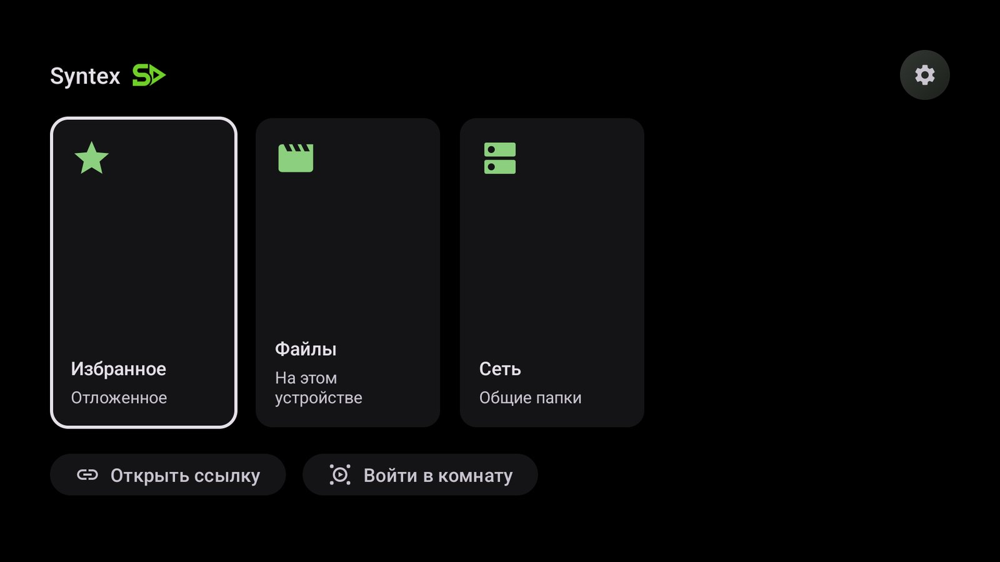

 * **Network:** SMB 2/3, WebDAV, DLNA/UPnP and TorrServer. Servers in the home network turn up by themselves, others are added by address, and a password is asked for when a share needs one. On a TorrServer a magnet link can be added and a torrent removed
 * **Files:** the box's own storage, shown as rows, tiles or columns, each video with its resolution, size, date and the point where you stopped
 * Search in the open folder or in all of it; folders and files can be starred into Favorites; playing a file queues the rest of its folder
 * On request: access to every folder (Android 11+), hidden files, folders marked `.nomedia`

**Player**

 * Back needs a second press to leave the player, or one, as you choose
 * Ten ways to fit the picture — the frame as it is, cropped, stretched, or forced to a common aspect ratio; Up and Down zoom
 * Playback speed from 0.25× to 4×; a sleep timer from a quarter of an hour to 12 hours that fades the sound out at the end
 * Audio, subtitles, quality, speed, timer, playlist and chapters each have a side panel; the rest is under ⋮ More
 * A clock over the picture and a line with the buffer, network speed and average bitrate above the bar, if you want them

**Picture**

 * Dolby Vision, HDR10 and HDR10+ where the box and the TV support them; for Dolby Vision profile 7 — a choice between an ordinary HEVC decoder and keeping Dolby Vision away from the decoder; 10-bit AV1, Dolby Vision profile 10 included
 * When the box cannot decode the video track, the player says so rather than playing sound over a black screen

**Subtitles**

 * Size, colour, weight, background and outline, previewed as you change them
 * A second line in another language — all the time, or only while paused
 * Online search (OpenSubtitles and other sources), by hand or by itself when your language is missing; machine translation when no subtitles in it exist anywhere

**Skip segments**

 * Intros, recaps, ads and end credits are marked on the bar; they come from the launching app or from online databases (SkipDB, IntroDB, Aniskip and others), where several sources have to agree
 * For intros and for credits separately: a Skip button, a button for the whole segment, or skipping without asking; a skip can always be taken back

**Watch together**

 * Two or more viewers see the same moment: play, pause and seek are shared. A room is created here or joined by code, invite link or QR code. It speaks LAMPA's `lparty` protocol, so someone watching in the web player can be in the same room

**Other**

 * Updates come from this repository's releases, with the list of changes shown first
 * When something fails, a screen explains it in plain words and lets you copy, share or upload the report; a load that never starts, a stall and a frozen picture are caught and retried
 * Material 3 look: dark, light or as the system, pure black for OLED, a choice of accent colours
 * Picture-in-picture, media controls from the system, pause when headphones are unplugged, system-wide equalizers

<details>
<summary>По-русски</summary>

**Браузер**

 * На ТВ приложение открывается страницей с тремя карточками — Избранное, Файлы, Сеть — и кнопками «Открыть ссылку» и «Войти в комнату»
 * **Сеть:** SMB 2/3, WebDAV, DLNA/UPnP и TorrServer. Серверы домашней сети находятся сами, остальные добавляются по адресу; если папке нужен пароль, его спросят. В TorrServer можно добавить магнет-ссылку и удалить торрент
 * **Файлы:** память самой приставки строками, плитками или колонками; у каждого видео разрешение, размер, дата и место, где вы остановились
 * Поиск в открытой папке или во всём её содержимом; папки и файлы — в Избранное; запуск файла ставит в очередь остальное из его папки
 * По желанию: доступ ко всем папкам (Android 11+), скрытые файлы, папки с `.nomedia`

**Плеер**

 * «Назад» выходит из плеера со второго нажатия или с первого — как настроите
 * Десять способов вписать картинку — как есть, с обрезкой, растянуть или привести к одной из обычных пропорций; вверх и вниз — увеличение
 * Скорость от 0,25× до 4×; таймер сна от четверти часа до 12 часов, к концу звук затихает
 * У звука, субтитров, качества, скорости, таймера, плейлиста и глав — своя боковая панель; остальное в ⋮ «Ещё»
 * Часы поверх картинки и строка с буфером, скоростью сети и средним битрейтом над полосой — если нужны

**Изображение**

 * Dolby Vision, HDR10 и HDR10+, если их поддерживают приставка и телевизор; для Dolby Vision профиля 7 — выбор: обычный декодер HEVC или не передавать Dolby Vision декодеру; 10-битный AV1, включая Dolby Vision профиля 10
 * Если приставка не может декодировать видеодорожку, плеер об этом говорит, а не играет звук на чёрном экране

**Субтитры**

 * Размер, цвет, жирность, фон и обводка — с предпросмотром по ходу настройки
 * Вторая строка на другом языке — всё время или только на паузе
 * Поиск в сети (OpenSubtitles и другие источники) вручную или сам, когда вашего языка нет; машинный перевод, когда субтитров на нём нет нигде

**Пропуск сегментов**

 * Вступления, пересказы, реклама и титры отмечены на полосе; они приходят из приложения-источника или из сетевых баз (SkipDB, IntroDB, Aniskip и другие), где несколько источников должны совпасть
 * Отдельно для вступления и для титров: кнопка «Пропустить», кнопка на весь сегмент или пропуск без вопроса; любой пропуск можно вернуть

**Совместный просмотр**

 * Двое и больше зрителей видят один и тот же момент: пауза, воспроизведение и перемотка общие. Комната создаётся здесь или находится по коду, ссылке-приглашению или QR-коду. Протокол — `lparty` из LAMPA, так что зритель в веб-плеере может быть в той же комнате

**Прочее**

 * Обновления — из выпусков этого репозитория, сначала показывается список изменений
 * Если что-то сломалось, экран объясняет это простыми словами и даёт скопировать, отправить или выгрузить отчёт; загрузка, которая не начинается, остановка и застывшая картинка ловятся и повторяются
 * Оформление Material 3: тёмное, светлое или как в системе, чисто чёрное для OLED, выбор акцентного цвета
 * «Картинка в картинке», управление из системы, пауза при отключении наушников, системные эквалайзеры

</details>

## Phones and tablets

Syntex runs on phones and tablets: touch gestures for seeking, volume and brightness, pinch to zoom, screen lock and picture-in-picture are in place. But the work goes into the TV, and phones and tablets are not tested. Expect a feature here and there that looks or behaves as if a remote were in your hand.

<details>
<summary>По-русски</summary>

Syntex работает на телефонах и планшетах: жесты перемотки, громкости и яркости, масштаб щипком, блокировка экрана и «картинка в картинке» на месте. Но работа идёт над версией для ТВ, а на телефонах и планшетах ничего не проверяется. Местами что-то может выглядеть или вести себя так, будто в руке пульт.

</details>

## Supported formats

 * **Video**: H.264, H.265 HEVC, VP8, VP9, AV1 (8- and 10-bit) by the device's decoders; MPEG-4 ASP (XviD, DivX), H.263, MS-MPEG-4, VC-1, MPEG-1/2, MJPEG by the built-in software decoder (8-bit SDR, no deinterlacing)
 * **Audio**: AAC, MP3, MP2, Vorbis, Opus, FLAC, ALAC, PCM, AMR, AC-3, E-AC-3, DTS, DTS-HD, TrueHD, IAMF, MPEG-H
 * **Containers**: MKV, MP4, MOV, WebM, AVI, M2TS, MPEG-TS, MPEG-PS, Ogg, FLV
 * **Streaming**: HLS, DASH, SmoothStreaming, RTSP
 * **Network**: SMB 2/3, WebDAV, DLNA/UPnP, TorrServer
 * **Subtitles**: SRT, SSA/ASS (styling partly), TTML, WebVTT, DVB

HDR10, HDR10+ and Dolby Vision where the hardware supports them. Not supported: WMV, Theora, ProRes, and on most devices 10-bit H.264.

<details>
<summary>По-русски</summary>

 * **Видео**: H.264, H.265 HEVC, VP8, VP9, AV1 (8 и 10 бит) — декодерами устройства; MPEG-4 ASP (XviD, DivX), H.263, MS-MPEG-4, VC-1, MPEG-1/2, MJPEG — встроенным программным декодером (8 бит, SDR, без деинтерлейса)
 * **Звук**: AAC, MP3, MP2, Vorbis, Opus, FLAC, ALAC, PCM, AMR, AC-3, E-AC-3, DTS, DTS-HD, TrueHD, IAMF, MPEG-H
 * **Контейнеры**: MKV, MP4, MOV, WebM, AVI, M2TS, MPEG-TS, MPEG-PS, Ogg, FLV
 * **Потоки**: HLS, DASH, SmoothStreaming, RTSP
 * **Сеть**: SMB 2/3, WebDAV, DLNA/UPnP, TorrServer
 * **Субтитры**: SRT, SSA/ASS (оформление частично), TTML, WebVTT, DVB

HDR10, HDR10+ и Dolby Vision — на поддерживающем оборудовании. Не поддерживаются: WMV, Theora, ProRes и на большинстве устройств 10-битный H.264.

</details>

## Questions

**Where are the settings?** On a TV, the gear on the start page; in the browser, ⋮ → Settings; in the player, ⋮ More → Settings, or hold ⋮.

**How do I add a NAS?** Network → Add network folder. SMB, DLNA and TorrServer servers in the home network are listed by themselves; WebDAV and anything else is added by its address.

**Where do subtitles come from?** A subtitle file with the video's name next to it is picked up by itself (see [Subtitles next to the file](#subtitles-next-to-the-file)). ⋮ More → Find subtitles online searches the online sources; Settings → Subtitles can make that search, and the translation, happen by themselves. On a TV a subtitle file of your own can also be opened from a file manager right after the video: it goes to the video played last.

**The sound is behind the picture.** Open the sound panel and move the audio delay while you watch; it is kept for that output from then on.

**What will it not play?** WMV, Theora and ProRes, and 10-bit H.264 on most boxes. Syntex is a video player: audio files alone are not its job.

**Android 16 on a phone: the rotate button does nothing.** Android 16 no longer lets an app turn the screen by itself. In the system settings, under the app's aspect ratio, switch Syntex from "Full screen" to "App default".

**Why can it ask to modify system settings?** Only on a phone: the system folder picker ignores the player's orientation, and with this permission Syntex turns auto-rotate on just while the picker is open. Everything else works without it.

<details>
<summary>По-русски</summary>

**Где настройки?** На ТВ — шестерёнка на стартовой странице; в браузере — ⋮ → Настройки; в плеере — ⋮ «Ещё» → Настройки или удержание ⋮.

**Как добавить NAS?** Сеть → Добавить сетевую папку. Серверы SMB, DLNA и TorrServer в домашней сети появятся в списке сами; WebDAV и всё остальное добавляется по адресу.

**Откуда берутся субтитры?** Файл субтитров с именем видео рядом с ним подхватывается сам (см. «Subtitles next to the file»). ⋮ «Ещё» → «Найти субтитры в сети» ищет по сетевым источникам; в Настройки → Субтитры можно сделать поиск и перевод автоматическими. На ТВ свой файл субтитров можно открыть из файлового менеджера сразу после видео — он достанется последнему видео.

**Звук отстаёт от картинки.** Откройте панель звука и подвиньте задержку прямо во время просмотра; дальше она хранится для этого выхода.

**Что он не сыграет?** WMV, Theora, ProRes и на большинстве приставок 10-битный H.264. Syntex — видеоплеер: отдельные аудиофайлы — не его задача.

**Android 16 на телефоне: кнопка поворота не работает.** Android 16 больше не даёт приложению поворачивать экран самому. В настройках системы, в пропорциях приложения, переключите Syntex с полноэкранного режима на режим по умолчанию для приложения.

**Зачем он может просить изменение системных настроек?** Только на телефоне: системный выбор папки не слушается ориентации плеера, и с этим разрешением Syntex включает автоповорот лишь на время выбора. Всё остальное работает и без него.

</details>

## Support

Syntex is maintained for my own devices and library. Issues with a clear description are welcome and read, but there is no promise of a fix or a reply time.

<details>
<summary>По-русски</summary>

Syntex развивается под мои устройства и мою библиотеку. Issue с внятным описанием приветствуются и читаются, но ни исправления, ни срока ответа это не обещает.

</details>

## For developers

### Building

You need JDK 17 or newer; the Gradle wrapper fetches the rest.

```bash
./gradlew assembleLatestUniversalDebug   # a debug APK
./gradlew build                          # lint, unit tests and every variant
```

The variants combine a target SDK (`latest` — 36, `legacy` — 29, for the old storage model) with a distribution (`universal` — with the built-in updater, `amazon`, `accrescent`). Releases are `latestUniversal`.

To sign a release build, give `RELEASE_STORE_FILE`, `RELEASE_STORE_PASSWORD`, `RELEASE_KEY_ALIAS` and `RELEASE_KEY_PASSWORD` in `local.properties`, as `-P` properties or as environment variables. Without them the release APK comes out unsigned.

The Media3 decoder extensions — ffmpeg (for AC-3, DTS and TrueHD), AV1, IAMF, MPEG-H — and a matching Media3 core are not built here: they sit in `app/libs/` as ready `.aar` files, and `media3_version` in `app/build.gradle` must match them. The AV1 one is rebuilt for 10-bit; the others are upstream's as published. Details: [`app/libs/README.md`](app/libs/README.md). The software video decoder is built from [`ffvideo/`](ffvideo).

### Starting Syntex from another app

Send `ACTION_VIEW` with the video's URI as data and `com.syntex.player` as the package. For a `content://` URI add `FLAG_GRANT_READ_URI_PERMISSION`. Use `startActivityForResult` if you want to hear back.

```java
Intent intent = new Intent(Intent.ACTION_VIEW)
        .setPackage("com.syntex.player")
        .setDataAndType(Uri.parse(url), "video/*")
        .putExtra("title", "Machines");
startActivityForResult(intent, REQUEST_PLAY);
```

Optional extras for a single video:

| Extra | Type | What it does |
|---|---|---|
| `title` | String | Shown in the header; HTML entities are decoded |
| `thumbnail` | String | Poster beside the title |
| `position` | int, ms | Start here |
| `return_result` | boolean | Send the position back on exit |
| `headers` | String[] | HTTP headers as name, value, name, value… |
| `subs`, `subs.name` | Uri[], String[] | External subtitles and their labels, by index |
| `subs.enable` | Uri[] | The first entry is the subtitle to switch on |
| `segments` | String | Parts to skip, JSON (below) |
| `season`, `episode` | int | Which episode this is |
| `imdb_id`, `id` | String; String or int | IMDb and TMDB ids, for looking segments up online |
| `quality_levels`, `quality_urls` | String[]; String[] or Uri[] | Quality labels such as `1080p` and their URLs, by index |

For a queue, pass `video_list` (Uri[] or String[]) and per-item arrays in the same order: `video_list.name` (with `video_list.filename` as a fallback), `.thumbnail`, `.segments`, `.season`, `.episode`, `.imdb_id`, `.id`, `.subtitles` (a Bundle per item with `uris` and `names`), and `video_list.quality_levels.<i>` / `video_list.quality_urls.<i>` for item `<i>`. The item whose URI equals the intent's data is played first. String arrays may also come as `ArrayList<String>` or `CharSequence[]`; `subs`, `subs.name` and `headers` must be exactly the types above.

Syntex also takes the nested `playlist` Bundle that Just+ 2.1.1 introduced, and answers it through `result_callback` — see Just+'s [playlist API](https://github.com/just-plus-player/just-plus-player/blob/master/docs/PLAYLIST_API.md), sections 2–7. Voices (`voices`) and the track keys of the report are not implemented.

**Segments** are seconds; `duration_ms` is the length they were measured on, so they are rescaled to the actual file. `skip` holds intros, recaps and credits, `ad` holds advertising:

```json
{ "duration_ms": 2696000,
  "skip": [{ "start": 62, "end": 152 }],
  "ad":   [{ "start": 0,  "end": 12  }] }
```

**Who keeps the watch state.** Any of `position`, `return_result`, `subs`, `subs.enable`, `video_list` or `quality_levels` means the launching app owns the progress: Syntex remembers positions only for the session and stores nothing. `title` on its own does not count.

**What comes back** (with `return_result`): `RESULT_OK` with an intent in MX Player's format — action `com.mxtech.intent.result.VIEW`, the URI of the item that was playing last, `end_by` = `playback_completion` or `user`, and, when the viewer left early, `position` and `duration` in ms.

Syntex runs as a single task: a new `ACTION_VIEW` to a running player replaces what it plays, so a launcher can switch the source or the episode without restarting it.

**From a LAMPA plugin** nothing has to be built by hand: LAMPA turns the object given to `Lampa.Player.play()` — `url`, `title`, `thumbnail`, `quality`, `subtitles`, `segments`, `season`, `episode`, `imdb_id`, `headers`, `playlist` — into the extras above. Keep `url` exactly equal to its entry in `playlist`, name qualities by resolution (`1080p`, `720p`), give every subtitle both `url` and `label`, and keep the real extension in a subtitle's URL, since the format is taken from it.

## Credits

**The code Syntex is built on**

 * [Just Player](https://github.com/moneytoo/Player) by Marcel Dopita and [Just+ Player](https://github.com/just-plus-player/just-plus-player) by @levende, its fork. The source of Just+ 2.0.11, the last one published, is the base of Syntex, and the history of this repository is theirs up to that point — which is why GitHub lists their contributors here. Both are released under the Unlicense
 * [Media3](https://github.com/androidx/media) (Apache 2.0) — the player itself. Two of its extractors are carried here as modified copies with their headers kept: AVI (`com.brouken.player.avi`) and MPEG-PS (`com.brouken.player.ps`); each changed file says what was changed. The JNI side of the software video decoder is shaped after Media3's `vpx_jni.cc`
 * [FFmpeg](https://ffmpeg.org) 7.1 (LGPL 2.1, built without `--enable-gpl` and `--enable-nonfree`) — the software video decoder, linked statically. [`ffvideo/`](ffvideo) holds the build script, the JNI source and the FFmpeg tag: everything needed to rebuild and relink it. The way AVI frames are reordered (`genpts`, `mpeg4_unpack_bframes`) follows FFmpeg
 * [smbj](https://github.com/hierynomus/smbj) (Apache 2.0) — SMB; the pipelined reads sit in its package to reach what it does not expose
 * Translations of the inherited strings come from Just Player's [Weblate project](https://hosted.weblate.org/engage/just-player/)

**Behaviour matched to, no code taken**

 * **Just+ Player 2.1–2.4** — the releases after 2.0.11 are APK-only. Where Syntex does what a later Just+ does (the resume rules of 2.4.4, the time left of 2.4.5, a Matroska file without cues of 2.4.2, the nested playlist of 2.1.1), the behaviour was read off the release notes and the app and written anew
 * **[LAMPA](https://github.com/lampa-app/LAMPA)** — the launch and report contract, read off the shell's source
 * **[Kodi](https://kodi.tv)** — the names of the pictures next to a video, and how a player treats a Matroska file whose cues are missing or wrong
 * **[Plezy](https://github.com/edde746/plezy)** — the statistics card and the seek bar broken into chapters
 * **[Wholphin](https://github.com/damontecres/Wholphin)** — the bar of first letters beside a long folder
 * **[samba](https://www.samba.org)** — the read-ahead over SMB follows its own client (`cli_pull`)
 * **[Jellyfin](https://jellyfin.org)**, **[tinyMediaManager](https://www.tinymediamanager.org)**, **Emby** and **Plex** — the trickplay sets, pictures and folder names they leave next to a library, read as they write them
 * **[Nova Video Player](https://github.com/nova-video-player/aos-AVP)** and **[DDD Player](https://github.com/usmanec/dddplayer)** — read through for what to take next; nothing of theirs is in the code yet
 * **Vimu**, **MX Player**, **VLC**, **mpv** and the **Dune HD** media centre — the reference for what a file should look and sound like

## Licence

Syntex is released under the [MIT licence](LICENSE), copyright Sergey K. The Just and Just+ code it is built on is under the Unlicense; the Media3 copies stay under Apache 2.0 and FFmpeg under LGPL 2.1. Every third-party part and its licence: [THIRD_PARTY_NOTICES.md](THIRD_PARTY_NOTICES.md).

<details>
<summary>По-русски</summary>

**Сборка, запуск из других приложений, благодарности** — в английском тексте выше: он для разработчиков.

Syntex построен на исходниках [Just Player](https://github.com/moneytoo/Player) (Marcel Dopita) и [Just+ Player](https://github.com/just-plus-player/just-plus-player) 2.0.11 (@levende), играет через [Media3](https://github.com/androidx/media) и [FFmpeg](https://ffmpeg.org). История репозитория до 2.0.11 — их, поэтому GitHub показывает их участников среди контрибьюторов.

Лицензия Syntex — [MIT](LICENSE), © Sergey K. Код Just и Just+ — под Unlicense, копии из Media3 — под Apache 2.0, FFmpeg — под LGPL 2.1. Все сторонние части и их лицензии — в [THIRD_PARTY_NOTICES.md](THIRD_PARTY_NOTICES.md).

</details>
